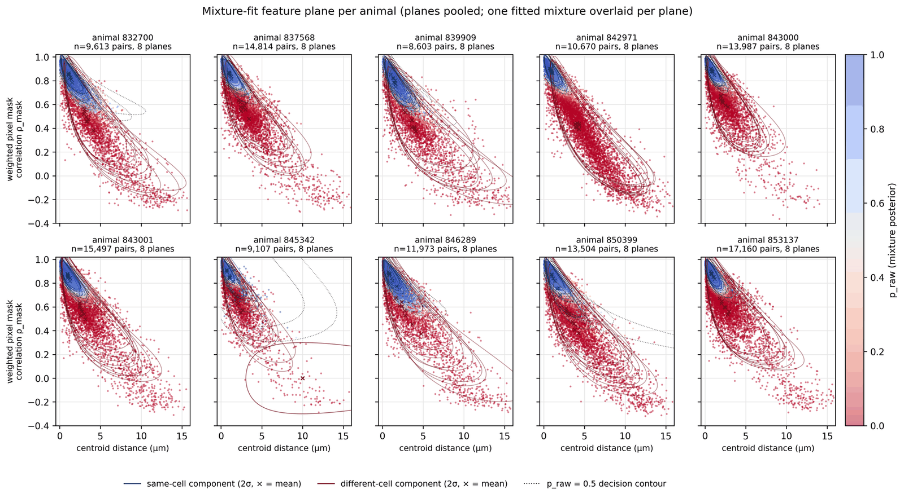
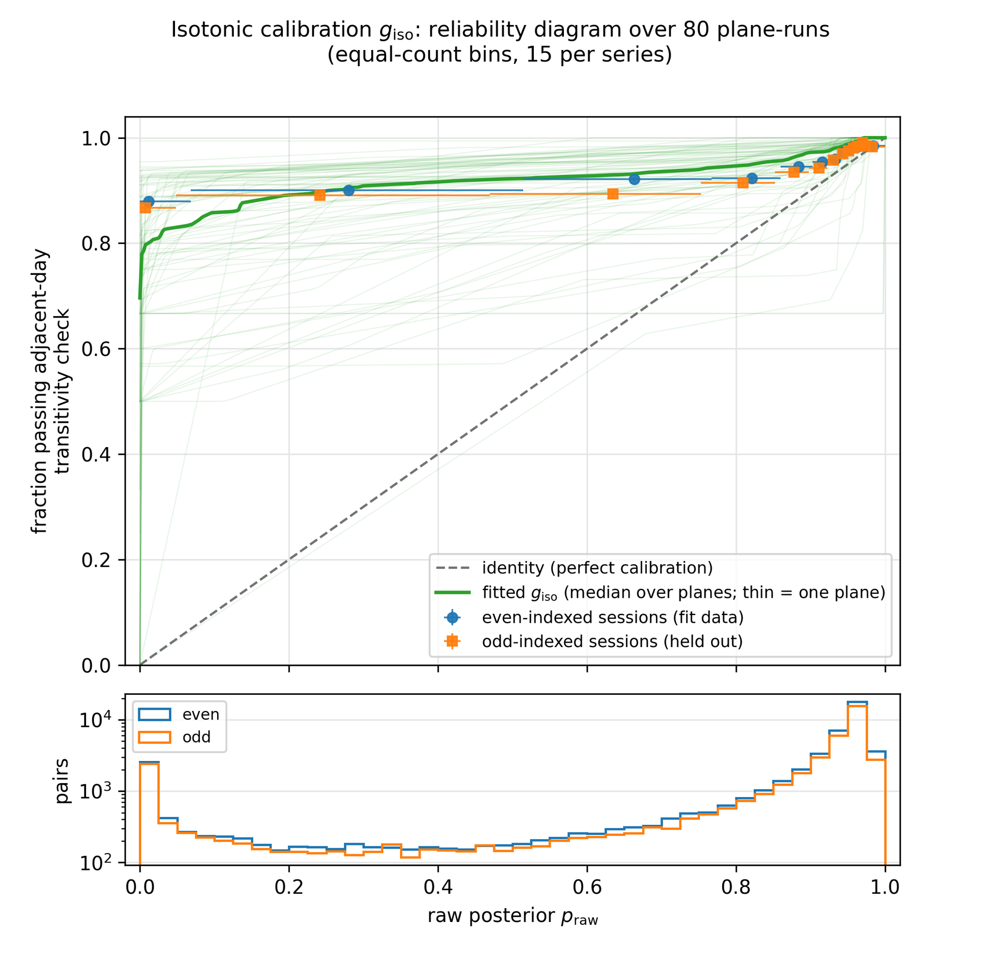
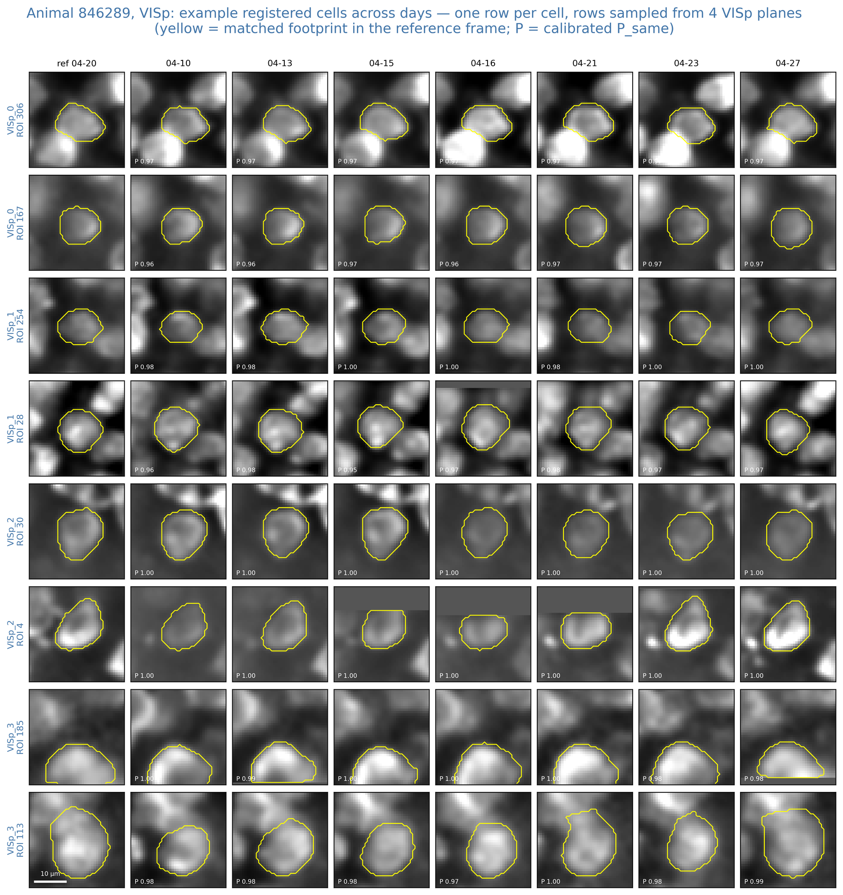
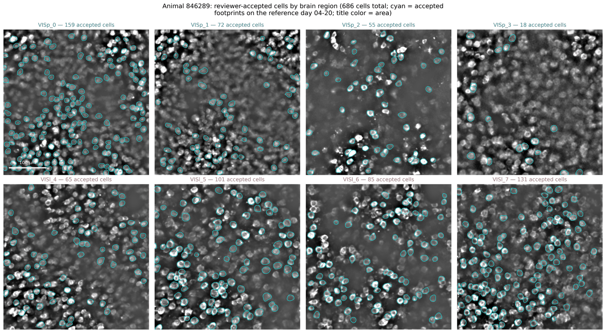
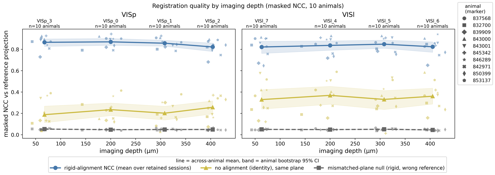
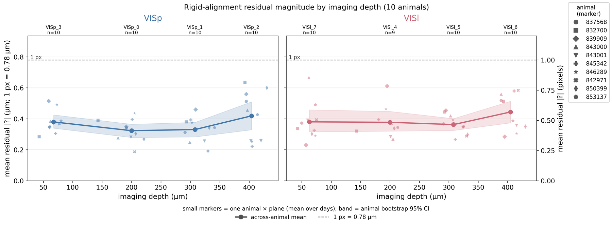
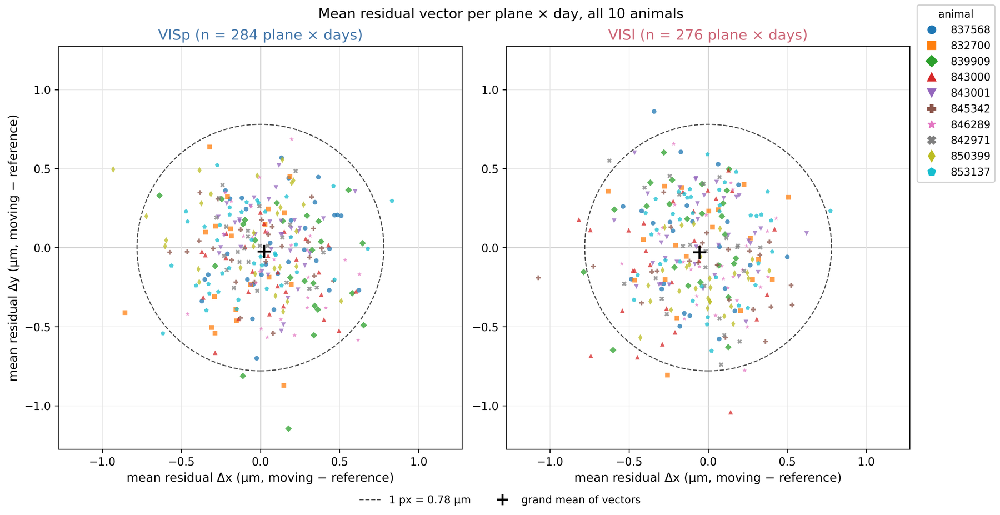
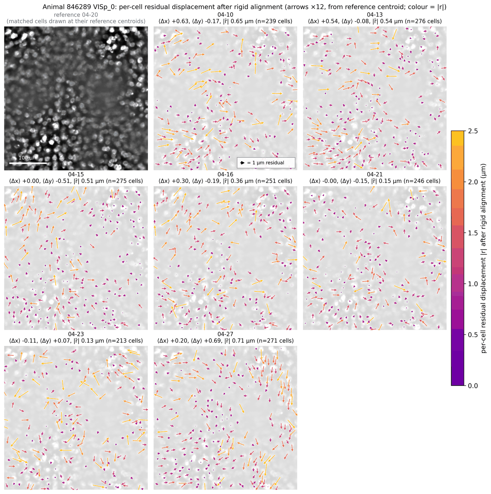

# openscope-registration-toolkit

**Cross-session cell registration for two-photon calcium imaging: the same cells, every day.**

Before any longitudinal single-cell claim can be made, you have to be sure you
are looking at the same cell on both days. This package registers cells across
weeks of recordings in five steps, run independently per imaging plane: align
each day's field of view onto a reference day, match cells one-to-one by
pixel-mask overlap, score every match with a calibrated same-cell probability,
review candidates by eye, and freeze a manifest of accepted identities that
downstream analyses consume without ever revisiting a match. Every stage ships
its own validation figures with chance-level controls.

It was built in the Oweiss Lab for the AIND OpenScope mesoscope dataset
(10 mice, 8 planes spanning VISp and VISl, 5–9 sessions over about 5 weeks).
The figures below are from that dataset. The core takes any session given as a
structural projection plus per-cell pixel masks.

```bash
pip install git+https://github.com/Oweiss-Lab/openscope-registration-toolkit.git
# with the AIND OpenScope S3 loader:
pip install "openscope-registration-toolkit[openscope] @ git+https://github.com/Oweiss-Lab/openscope-registration-toolkit.git"

python examples/run_synthetic_pipeline.py out/    # all five stages on synthetic data, no network, ~1 min
```

---

## The method: five steps

Each step is a function in [`pipeline.py`](src/openscope_registration/pipeline.py) and an
`osreg` subcommand ([`cli.py`](src/openscope_registration/cli.py)).

### Step 1, align images: `osreg register`

Each day's field of view is rotated (within ±3°) and shifted to sit on top of
a reference day. The transform is rigid (rotation plus shift, no stretching);
some residual non-rigid tissue change remains, but it is small relative to
cell size (quantified under *Validation*), and any cell it displaces beyond
tolerance is caught in manual review (Step 4).

Both images are first percentile-scaled, high-pass filtered to remove shared
illumination gradients and out-of-focus background, lightly smoothed, and
z-scored ([`rigid.preprocess_projection`](src/openscope_registration/rigid.py#L17)).
The rotation is found by grid search; for each angle the translation comes
from Hann-windowed phase correlation with a bounded search and parabolic
subpixel refinement ([`rigid.windowed_phase_shift`](src/openscope_registration/rigid.py#L49)),
and the candidate is scored by the masked normalized cross-correlation on the
pixels both images cover ([`rigid.masked_ncc`](src/openscope_registration/rigid.py#L79)).
The best-scoring (angle, shift) is the session's transform
([`rigid.register_rigid`](src/openscope_registration/rigid.py#L83)). The reverse
transform is also fitted and its inverse-consistency residual recorded, and
leftover per-tile shifts probe for local non-rigid failure
([`rigid.residual_tile_shifts`](src/openscope_registration/rigid.py#L103)).

### Step 2, match cells one-to-one: `osreg register`

All moving-day pixel masks are warped into the reference day's pixel frame
([`rigid.warp_footprints`](src/openscope_registration/rigid.py#L33)). Because the
masks are binary, overlap is scored by intersection-over-union: each
reference mask against each warped mask gives a table of overlap scores
([`matching.iou_matrix`](src/openscope_registration/matching.py#L30)).

| IoU | day cell 306 | day cell 231 | day cell 99 | day cell 255 | day cell 262 |
|---|---|---|---|---|---|
| ref cell 307 | **0.95** | 0.00 | 0.00 | 0.00 | 0.00 |
| ref cell 228 | 0.00 | **0.77** | 0.00 | 0.00 | 0.00 |
| ref cell 98  | 0.00 | 0.00 | **0.52** | 0.00 | 0.00 |
| ref cell 256 | 0.00 | 0.00 | 0.00 | 0.47 | 0.39 |

*Rows = reference-day masks, columns = warped moving-day masks, entries = IoU.
An excerpt from a real table (animal 837568, plane VISp_0, first recording day
against the reference day; full table 361 × 334 with 479 non-zero entries).
Data: [`docs/iou_example_table.csv`](docs/iou_example_table.csv).*

The Hungarian algorithm then matches each reference cell to at most one
moving-day cell and vice versa; the chosen pairing maximizes the summed IoU
over all pairs ([`matching.assign_matches`](src/openscope_registration/matching.py#L60)):

$$
\mathrm{IoU}(M_i, M_j) = \frac{|M_i \cap M_j|}{|M_i \cup M_j|}, \qquad \max_{\pi} \sum_i \mathrm{IoU}\!\left(M_i, M_{\pi(i)}\right)
$$

where $M_i$ is the pixel mask of reference-day cell $i$, $M_j$ the warped mask
of moving-day cell $j$, $|\cdot|$ counts pixels, and $\pi$ is a one-to-one
assignment. IoU ranges from 0 (disjoint) to 1 (identical masks).

A pair enters Step 3 only if IoU ≥ 0.5, the centroids are within 4 px, and
its IoU beats the runner-up's by ≥ 0.2. IoU ≥ 0.5 excludes partial overlaps
between neighbours; the centroid limit (3.1 µm at 0.78 µm/px, about 40 % of
the median soma radius of 7.2 µm measured from the reference-day masks)
removes pairs whose centroids are too far apart to be explained by alignment
error; the margin removes ambiguous pairs in which a second candidate overlaps
nearly as well as the best one. In the example table, ref cell 256 fails all
three. **These gates define the candidate pool, not acceptance**; the defaults
(`candidate_iou`, `max_centroid_px`, `min_iou_margin` in
[`pipeline.register_plane`](src/openscope_registration/pipeline.py#L60)) are
preparation-specific and should be checked for yours.

The same matching is also run between each pair of consecutive sessions
(the *adjacent-day assignments*), and each reference cell's chain of matches
is summarised as a candidate track
([`matching.build_tracks`](src/openscope_registration/matching.py#L135)).

### Step 3, score each pair: `osreg refine`

Each candidate pair is scored on two features, the weighted pixel-mask
correlation $\rho_\text{mask}$
([`matching.weighted_footprint_correlation`](src/openscope_registration/matching.py#L38))
and the centroid distance $d_\text{cent}$, with a two-component Gaussian
mixture fit by EM that separates same-cell pairs from mis-matches and gives
each pair a posterior $p_\text{raw}$
([`psame.fit_p_same`](src/openscope_registration/psame.py#L51)):

$$
p_\text{raw} = \Pr\!\left(\text{same} \mid \rho_\text{mask},\ \log(1 + d_\text{cent})\right), \qquad P_\text{same} = g_\text{iso}(p_\text{raw})
$$



*The two features the mixture is fit on, one panel per animal (planes pooled;
124,928 pairs). Each dot is one assigned cross-day pair, coloured by
$p_\text{raw}$; the fitted mixture is overlaid per plane: 2σ ellipses and ×
at the means of the same-cell (blue) and different-cell (red) components, and
the dotted $p_\text{raw}=0.5$ decision contour, mapped from the fit space into
the unlogged display axes. The same two-cluster geometry appears in every
animal. Figure: [`plotting.plot_p_same_feature_scatter_grid`](src/openscope_registration/plotting.py#L467), [`plotting.overlay_mixture_fit`](src/openscope_registration/plotting.py#L399).*

The mixture ranks pairs correctly, but its numerical values do not match how
often pairs are actually the same cell, so they are rescaled against an
independent check: **adjacent-day transitive consistency**. If reference cell
$r$ matches cell $j$ on day A and cell $k$ on the adjacent day B, then $j$ and
$k$ should also be paired when days A and B are matched directly
([`psame.adjacent_direct_assignments`](src/openscope_registration/psame.py#L158),
[`psame.transitive_consistency_flags`](src/openscope_registration/psame.py#L176)).
The fraction of pairs passing this check at each $p_\text{raw}$ is fit by
isotonic regression (monotone; rescales but cannot reorder pairs) on
even-indexed sessions and checked on odd-indexed ones
([`psame.fit_isotonic_calibration`](src/openscope_registration/psame.py#L108),
[`psame.apply_isotonic`](src/openscope_registration/psame.py#L138)). A
$P_\text{same}$ of 0.9 therefore means about 90 % of pairs with that score are
confirmed by a direct match between adjacent days.



*Calibration on the held-out sessions, pooled over 80 plane-runs. Top:
observed consistency fraction vs $p_\text{raw}$ in equal-count bins, for the
sessions the map was fit on (blue) and the held-out sessions (orange), with the
identity line and the fitted isotonic maps (green, thin per plane, bold
median). Bottom: pairs per bin. The raw posterior is conservative below ~0.9
and the correction generalizes: held-out points sit on the fitted curve.
Consistency is necessary, not sufficient: a stable wrong match passes every
triangle, so calibrated values at low scores bound rather than measure the
true same-cell probability. Figure: [`plotting.plot_reliability_diagram`](src/openscope_registration/plotting.py#L598).*

Step 3 also runs a rescue pass for cells the soma segmentation missed on some
days ([`rescue.py`](src/openscope_registration/rescue.py)) and writes every
per-pair consistency flag to `transitive_consistency_pairs.csv`
([`pipeline.run_identity_refinement`](src/openscope_registration/pipeline.py#L460)).

### Step 4, manual review: `osreg review`

Every track whose $P_\text{same} \ge 0.90$ on all days is inspected by eye in
a self-contained HTML GUI showing structural crops of the reference and each
aligned day with the matched mask outline; no activity, response, or model
information is visible to the reviewer
([`pipeline.run_review_gui`](src/openscope_registration/pipeline.py#L713),
[`review_html.build_manual_review_html`](src/openscope_registration/review_html.py#L44)).
In the OpenScope study all 4,300 review decisions across 10 animals were made
by eye; no automatic acceptance was used (a triage policy with a seeded audit
sample is available but off by default).



*What the reviewer sees: one row per cell, one column per session; yellow =
matched pixel mask in the reference frame, P = calibrated $P_\text{same}$ for
that session (animal 846289, rows sampled across planes).*

### Step 5, freeze: `osreg freeze`

The accepted list is fixed before any downstream analysis and used as-is, so
that matches cannot be revisited in light of the results they produce. A pair
is accepted only if the reviewer accepted the track **and** the pair was a
candidate with $P_\text{same} \ge$ threshold; every accepted track must then
cover every retained session exactly once
([`freeze.freeze_plane`](src/openscope_registration/freeze.py#L57),
[`pipeline.run_freeze_manifest`](src/openscope_registration/pipeline.py#L817)).
Downstream code reads only the frozen manifest
([`diagnostics.accepted_tracks_wide`](src/openscope_registration/diagnostics.py#L275)).



*Animal 846289: reviewer-accepted cells (cyan masks on the reference day),
686 cells total; VISp_0–3: 159 / 72 / 55 / 18; VISl_4–7: 65 / 101 / 85 / 131.*

---

## Validation: `osreg diagnose`

A registration is never certified by one score. The diagnostic battery
([`pipeline.run_registration_diagnostics`](src/openscope_registration/pipeline.py#L297),
metrics in [`diagnostics.py`](src/openscope_registration/diagnostics.py)) reports
centroid distances, mask correlation against a shuffled-pair null, per-cell
residual displacement, a local-geometry permutation test, coverage, and
footprint-size change (a Z-drift probe), each as a figure with its null drawn
alongside ([`plotting.py`](src/openscope_registration/plotting.py)). Three of the
checks used in the OpenScope study are shown here.

### Alignment quality across animals

Each session's alignment is scored with the masked NCC between the aligned
session's preprocessed average projection and the reference day's, computed
only over pixels both images cover. The high-pass filter is why the
no-alignment baseline sits at 0.2–0.4 rather than higher. Two references
anchor the scale: the same comparison with no alignment applied, and the
session aligned to the wrong plane's reference (mismatched-plane null).



*Masked NCC by imaging depth, 10 animals. Rigid alignment reaches NCC ≈
0.82–0.87 at every depth in both areas; the no-alignment baseline sits at
0.2–0.4 and the mismatched-plane null at ≈ 0.05. Line = across-animal mean,
band = animal bootstrap 95 % CI.*

### Residual displacement of individual cells

NCC scores the whole image. To check that the transform also aligns
individual cells, every matched cell's residual displacement $\mathbf r$ is
measured: the warped moving-day centroid minus the reference-day centroid, in
µm ([`diagnostics.residual_displacement_table`](src/openscope_registration/diagnostics.py#L53)).
The per-session mean $\bar{\mathbf r}$ is the part a better translation could
have removed; its magnitude is the systematic alignment error that remains
([`diagnostics.summarise_residual_vectors`](src/openscope_registration/diagnostics.py#L228)
also reports the share of residual variance explained by a common translation
and by a position-dependent affine term).



*Residual alignment error by depth (10 animals, 79 animal-planes). Small
markers = one animal × plane averaged over its days; line = across-animal
mean, band = animal bootstrap 95 % CI; dashed = 1 px (0.78 µm), right axis in
pixels. The mean residual is sub-pixel at every depth in both areas (plane
means 0.32–0.44 µm, 0.4–0.6 px).*



*Direction of the residual. Each point is one plane × day's mean residual
vector (n = 284 VISp, 276 VISl), coloured by animal; dashed circle = 1 px;
cross = grand mean. 96–97 % of sessions fall inside 1 px, the clouds are
isotropic, and the grand mean is below 0.06 µm in both areas: no
reference-frame bias.*



*Cell by cell, one plane. Top-left: the reference-day projection; every other
panel one recording day. Each arrow starts at a matched cell's reference-day
centroid and points to where it landed after the rigid transform, drawn 12×
longer than its true displacement (boxed key = 1 µm), coloured by $|\mathbf r|$.
A wrong transform would give arrows sharing one direction or sweeping
coherently with position; a right one gives short arrows pointing every way.
Panel titles give the session's mean residual vector and cell count. Figure:
[`plotting.draw_residual_displacement_panel`](src/openscope_registration/plotting.py#L106).*

---

## Running it

```bash
osreg register --sessions S1 S2 S3 --reference-session S2 --planes VISp_0 VISl_4 --numerical-dir out/reg
for P in VISp_0 VISl_4; do
  osreg diagnose --registration-root out/reg --plane $P --numerical-dir out/battery_$P --figure-dir figs/battery_$P
  osreg refine   --registration-root out/reg --plane $P --numerical-dir out/refine_$P  --figure-dir figs/refine_$P
  osreg review   --registration-root out/reg --refinement-run out/refine_$P --plane $P --output-root out/review
done
# open out/review/manual_review_<plane>.html, decide, export the CSV into out/review, then:
osreg freeze --gui-run out/review --planes VISp_0 VISl_4 --refinement-runs out/refine_VISp_0 out/refine_VISl_4 --output-root out/frozen
```

Stages `diagnose`, `refine` and `review` read the reference session, session
order and transforms from the `register` run directory, so a full run needs
only session ids, plane names and output paths. Data-reading stages take
`--source openscope` (AIND S3 planar NWB zarr,
[`io/openscope.py`](src/openscope_registration/io/openscope.py)) or
`--source npz --npz-dir DIR` ([`io/npz.py`](src/openscope_registration/io/npz.py)).
Every stage writes a `manifest.json` with parameters, input/output hashes, and
stated limitations ([`manifests.py`](src/openscope_registration/manifests.py)).

### Your own data

A session is a [`SessionStructuralData`](src/openscope_registration/data.py): a
structural projection, per-cell pixel masks (weighted or binary), stable ROI
ids, and the pixel size.

```python
from openscope_registration import SessionStructuralData
from openscope_registration.io import save_npz_session

session = SessionStructuralData(
    session_id="mouseA_2026-01-05",
    projection=mean_image,          # (H, W)
    footprints=masks,               # (n_cells, H, W), >= 0
    roi_ids=ids,                    # (n_cells,) ints, unique within the session
    pixel_size_um=0.78,
    metadata={"depth_um": 200.0},   # optional
).validate()
save_npz_session("sessions/mouseA_2026-01-05.npz", session)   # then: osreg ... --source npz --npz-dir sessions
```

Or call the stages directly: `from openscope_registration import register, diagnose, refine, review, freeze`.

### Consuming the result

```python
from openscope_registration import accepted_tracks_wide, derive_retained_and_reference
retained, reference = derive_retained_and_reference(["out/frozen"], set(all_session_ids))
wide = accepted_tracks_wide("out/frozen", "visp0", reference)   # index = reference ROI id, one column per session
```

---

## Verification

- 39 tests on synthetic ground truth (`pytest`): rigid transform recovery,
  identity matching, planted same/different separation, isotonic recalibration
  of under-confident posteriors, rescue, freeze integrity, and the five stages
  end to end on local `.npz` sessions
  ([`tests/test_pipeline_smoke.py`](tests/test_pipeline_smoke.py)).
- Reproduction on real data (animal 846289, OpenScope S3): `register` on two
  planes matches the original study pipeline's transforms, NCC, candidate
  pairs and tracks exactly; `refine` and `freeze` on VISp_0 reproduce the
  study's frozen run bit-for-bit (2,196 scored pairs, 159 accepted tracks).
  Re-run with [`tests/test_pilot_reproduction.py`](tests/test_pilot_reproduction.py)
  when the reference outputs are available.

## Package layout

```
src/openscope_registration/
  data.py          SessionStructuralData, RigidTransform
  rigid.py         preprocessing, phase correlation, register_rigid, warps, masked NCC, tile residuals
  matching.py      IoU table, Hungarian assignment + gates, weighted mask correlation, build_tracks
  psame.py         mixture model, transitive consistency, isotonic calibration, reliability bins
  rescue.py        classifier-override rescue, back-projection evidence
  diagnostics.py   battery metrics, residual summaries, frozen-manifest consumption
  freeze.py        acceptance rule and integrity checks
  pipeline.py      the five stage functions (register, diagnose, refine, review, freeze)
  plotting.py      every figure
  review_html.py   manual-review GUI builder
  manifests.py     manifest writer with hashes
  cli.py           `osreg` entry point
  io/              npz loader/saver; optional AIND OpenScope S3 adaptor
tests/  examples/  docs/
```

## References

The matching-by-mask-overlap and probabilistic same-cell scoring follow
Sheintuch et al. 2017 (CellReg); rigid registration by phase correlation on
high-passed projections follows Pnevmatikakis & Giovannucci 2017 (NoRMCorre).
Data format: AIND OpenScope planar NWB zarr. See [CITATION.cff](CITATION.cff)
to cite this package.

## License

MIT. See [LICENSE](LICENSE).
